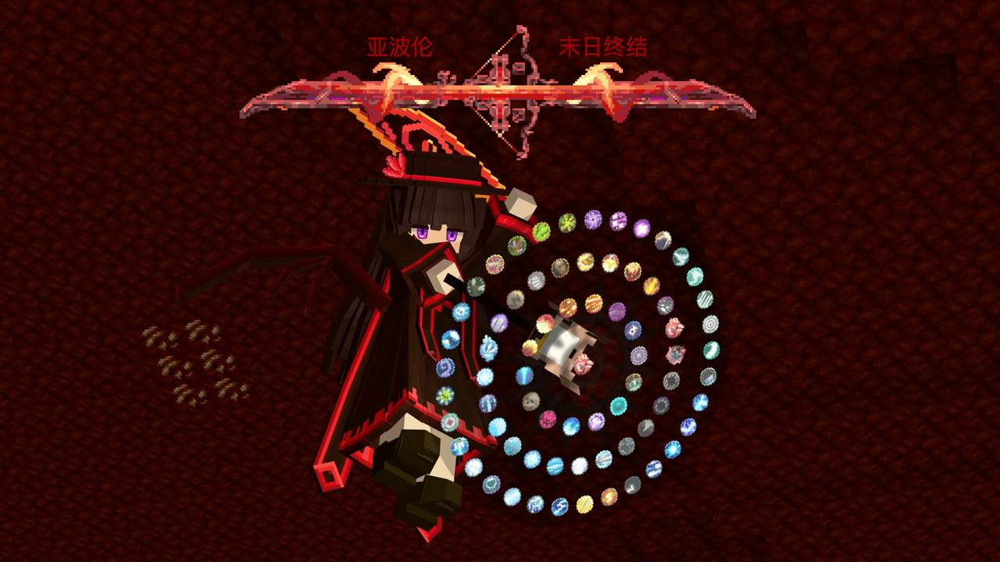
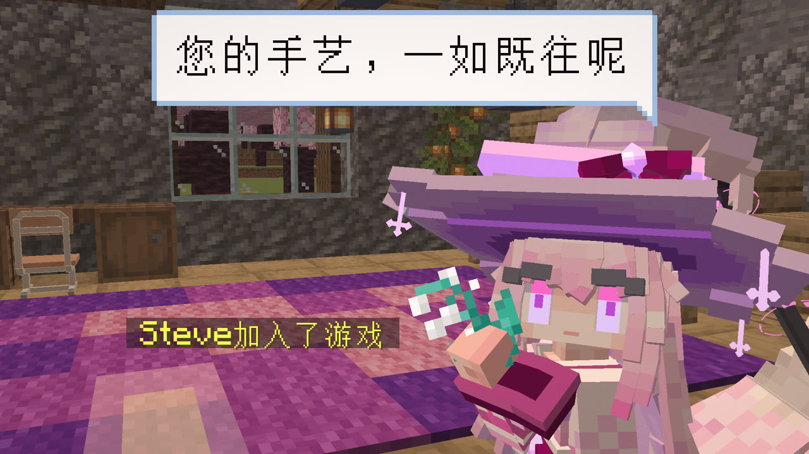

<h1 align="center">mc-anim</h1>

用 <a href="https://www.remotion.dev/">Remotion</a> + <a href="https://threejs.org/">three.js</a> 逐帧渲 Minecraft 动画 方块、模型、贴图、动作、音效、地形都取自原版和模组的真实资源

 

| 作品 | 简介 | 时长 | 视频 |
|---|---|---|---|
| **亚波伦不放水** | 诡厄巫法 boss 战短片，全法术齐放 | 0:40 | [B 站](https://www.bilibili.com/video/BV1Rqsh6yEka) |
| **把回忆拼好给你** | MC 短片，配歌 | 0:56 | [B 站](https://www.bilibili.com/video/BV1WjHg6ZEPy) |
| **应力转动** | 小说《机械动力应力转动》改编漫剧，第 6、7 章 | 5:55 | [B 站](https://www.bilibili.com/video/BV1hHnA67EEi) |

画面在浏览器里用 WebGL 一帧一帧算出来，再接成成片。把回忆拼好给你和应力转动渲片要的全部素材，连配乐和配音，都挂在本仓库的 GitHub Release 上：clone 下来、拉完素材，就能在自己电脑上渲出和作者一样的成片。

## 在自己电脑上渲出来

步骤都在 [docs/从零渲染.md](docs/从零渲染.md)，从一台什么都没装的 Windows 电脑写起，Mac / Linux 的差别在最后一节。

不用自己敲命令：交给 Claude Code、Codex、Cursor 这类能在终端里跑命令的 AI 编程助手，跟它说「照这个仓库的 docs/从零渲染.md 把作品渲出来」就行。想改作品、做自己的，也一样交给它，从 [docs/二次开发.md](docs/二次开发.md) 读起。

## 要准备什么

| 项 | 大概 |
|---|---|
| 电脑 | Windows 10 / 11（64 位）、Mac 或 Linux；独立显卡最好；内存 16 GB 起 |
| 硬盘 | 留 40 GB 左右，大头是渲染中间的切片和成片 |
| 时间 | 装工具、下载 0.5～1 小时。出片：作者的 Mac 上应力转动约 2 小时，把回忆拼好给你几十分钟，Windows 一般慢一半左右 |

## 下载源

考虑到不是人人都有代理，能走国内镜像的都走国内镜像：

- **国内镜像（不用代理）**：Git、Node、ffmpeg 的安装包，pnpm 和全部 npm 依赖，渲染用的浏览器。都从 [npmmirror](https://npmmirror.com/) 下。
- **只在 GitHub 上（国外，最好走代理）**：代码、一个 npm 依赖（`gelatin-game-engine`）、素材（Release 附件）。直连有时也能下，只是慢、容易断，断了重跑会接着下；素材每个附件都核 sha256，换个下载地址也不怕下到被改过的。

怎么设代理、没代理怎么办，见 [docs/从零渲染.md](docs/从零渲染.md)「6. 代理」。

## 文档

| 文档 | 给谁看 |
|---|---|
| [docs/从零渲染.md](docs/从零渲染.md) | 想在自己电脑上渲出成片的人（和他们的 AI 助手） |
| [docs/二次开发.md](docs/二次开发.md) | 想改作品、加素材、做自己作品的人 |
| [docs/架构.md](docs/架构.md)、[docs/命名.md](docs/命名.md) | 要读代码的人，先看这两篇 |
| [docs/新段.md](docs/新段.md)、[docs/世界.md](docs/世界.md)、[docs/游戏导表.md](docs/游戏导表.md) | 写新段、改地形、从游戏取数据 |
| [动作体检](docs/动作体检.md)、[亚波伦 YSM 往返](作品/亚波伦不放水/制作/ysm/README.md) | 查同镜跳位、穿裙和视频帧距，或编辑 YSM 模型、贴图与舞轨 |
| [docs/决策/](docs/决策/) | 每个大决定为什么这样做；公开素材的来龙去脉在 [0017-全部公开.md](docs/决策/0017-全部公开.md) |
| [assets/README.md](assets/README.md) | 素材怎么登记、存在哪、怎么核对 |

`anim help` 列出全部命令，单条命令看 `anim <命令> --help`（Windows 用 `.\anim.cmd`）。

## 素材来源

- Minecraft 的贴图、模型、音效、字体和从游戏世界导出的场景版权归 Mojang。本项目是非官方作品，与 Mojang 无关。NOT AN OFFICIAL MINECRAFT PRODUCT. NOT APPROVED BY OR ASSOCIATED WITH MOJANG OR MICROSOFT.
- 车万女仆（Touhou Little Maid）的模型、贴图、音效，和魔法酒狐模型：模型作者星海ELIYA、伊蕾娜教代行教皇，贴图作者百花，CC BY-NC-SA 4.0。九胡的音色参考取自车万女仆自定义模型包里的语音。
- 万法皆通（Touhou Little Maid: Spell，作者 yimeng261）的贴图和音效：MIT。
- 铁魔法（Iron's Spells 'n Spellbooks）、Lootr、暮色森林（The Twilight Forest）、机械动力（Create）和其他模组、整合包的模型、贴图、音效、结构归各自作者。
- 大气光照代码改写自 Photon 光影，许可见 `engine/light/大气/Photon-LICENSE.txt`。
- 「把回忆拼好给你」的原版贴图换成了 Faithful 64x 材质包（Faithful Resource Pack，https://faithfulpack.net ），按 Faithful License v4（https://faithfulpack.net/license ）使用和再分发；换了哪些见 `作品/把回忆拼好给你/材质包.锁.json`。本项目和 Faithful 团队无关。
- 每件素材的来源、许可登记在 `assets/registry/*.toml` 和 `作品/<名>/资产表/*.toml`。
- 作品不商用。

## 许可

本仓库自己写的代码和文档用 [MIT 许可](LICENSE)。下面这些不在 MIT 里，按各自的协议：

- **第三方素材**（贴图、模型、音效、字体、结构、世界存档、地形包、配乐、音色参考）：按上面「素材来源」和每件素材在资产表里登记的许可。随仓库带的 `字节/`、Release 附件里的字节一样。
- **移植自第三方的代码**：文件头写明出处和许可。现在只有 `engine/light/` 下移植自 Photon 光影的大气、云、高度雾、天色几处，按 Photon Shaders License（全文 `engine/light/大气/Photon-LICENSE.txt`）。
- **改编自小说《机械动力应力转动》的剧情、台词**：原作者授权在本仓库再分发，不另行授权。
